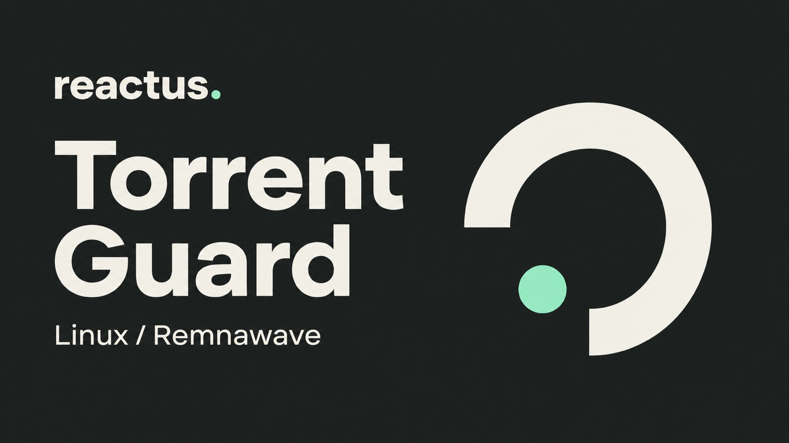

<p align="center">
  
</p>

<p align="center">
  <strong>Локальный фильтр открытого BitTorrent-трафика для Linux и VPN-нод.</strong>
</p>

## Установка

Одна команда для установки с автозапуском на Linux с systemd.

```bash
curl -fsSL https://github.com/valentinvelnesev-alt/torrent-guard/raw/main/install.sh | sudo sh
```

После установки проверь правила и счётчики командой `sudo torrent-guard status`.

<details>
<summary>Требования и временный запуск</summary>

Понадобятся Bash, `curl`, `flock`, `iptables`, `ip6tables` и модули ядра `xt_string` и `xt_connbytes`. В Ubuntu и Debian обе команды iptables входят в пакет `iptables`.

Чтобы проверить работу фильтра до включения автозапуска, скачай репозиторий.

```bash
git clone https://github.com/valentinvelnesev-alt/torrent-guard.git
cd torrent-guard
sudo bash guard.sh apply
sudo bash guard.sh status
```

Временные правила действуют до перезагрузки или выполнения `sudo bash guard.sh remove`. Проверь SSH и VPN, затем включи автозапуск командой `sudo bash guard.sh install`.

</details>

## Управление

| Команда | Действие |
| --- | --- |
| `sudo torrent-guard status` | Показать правила и счётчики отброшенных пакетов |
| `sudo torrent-guard apply` | Восстановить правила после перезагрузки конфигурации firewall |
| `sudo torrent-guard remove` | Снять правила до следующего запуска сервиса или перезагрузки |
| `sudo torrent-guard uninstall` | Удалить фильтр и его автозапуск |

## Фильтрация

Фильтр распознаёт TCP-рукопожатия BitTorrent, открытые HTTP-запросы к трекерам, запросы подключения к UDP-трекерам, DHT и локальное обнаружение пиров. Остальной трафик обрабатывают действующие правила firewall.

<details>
<summary>Как устроен фильтр и где он ограничен</summary>

Скрипт добавляет цепочку `TORRENT_GUARD` к `INPUT`, `OUTPUT` и `FORWARD` для IPv4 и IPv6. При наличии счётчиков conntrack он ищет сигнатуры в первых 8 КиБ трафика соединения суммарно в обоих направлениях. Для работы фильтра внешний API не нужен.

Фильтр проверяет отдельные пакеты. Он может пропустить зашифрованный BitTorrent, HTTPS-трекеры, сигнатуры, разбитые по нескольким пакетам, и трафик внутри другого шифрованного туннеля.

Форматы пакетов описаны в [BEP 3](https://www.bittorrent.org/beps/bep_0003.html), [BEP 5](https://www.bittorrent.org/beps/bep_0005.html), [BEP 14](https://www.bittorrent.org/beps/bep_0014.html) и [BEP 15](https://www.bittorrent.org/beps/bep_0015.html).

</details>

---

<p align="center">
  Автор&nbsp;·&nbsp;<a href="https://reactus.club"><strong>Reactus</strong></a>
</p>
